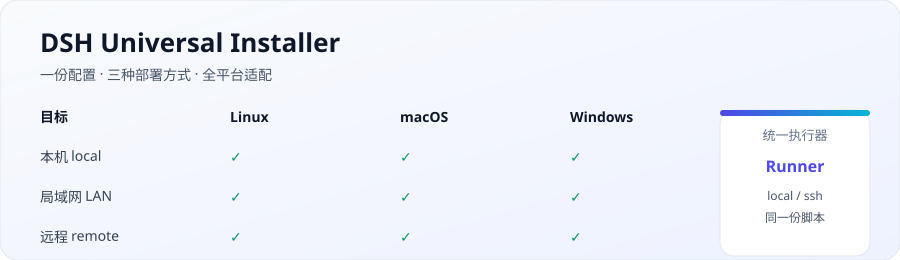

# DSH Universal Installer

[](https://github.com/zhanglmyf/dsh-universal-installer/stargazers)
[](LICENSE)
[](https://www.python.org/)
[](CONTRIBUTING.md)

**中文** | [English](README.en.md)

一份配置，把 [DeepSeek Harness](https://github.com/deepseek-ai) 装到**任何系统、任何位置**——本机、局域网主机、远程服务器，跨平台统一部署。



## 特性

- **三种部署方式，一套接口**：本机直装 / 局域网 SSH / 远程 SSH（含跳板机），底层抽象成统一执行器
- **跨平台**：Linux（systemd-user）、macOS（launchd）、Windows（计划任务 / NSSM）自动适配
- **配置驱动**：主机、用户、端口、版本、路径全部来自 `config.json`，零硬编码
- **幂等可回滚**：重复运行不破坏已有配置，改动前自动备份
- **纯标准库**：编排器只需 Python 3.9+，无需 `pip install`
- **预演模式**：`--dry-run` 先看会做什么，`--show-script` 直接看生成的安装脚本

## DSH 版本与运行形态（先看这个）

DeepSeek Harness（dsh）目前是**开发者预览版**，迭代很快。它有三种运行形态，本项目部署的是第 2 种：

| 形态 | 平台 | 说明 |
|---|---|---|
| **官方桌面版** | Windows x64（EXE，Windows 10+）、macOS Apple Silicon（DMG，macOS 13+） | 图形应用，自带 Node 运行时，无需单独装 Node。**Intel Mac 与 Linux 没有官方桌面版**。 |
| **CLI / Web UI**（本项目） | Linux、macOS（含 Intel）、Windows、WSL | `npx @deepseek-ai/dsh web`，默认 `http://127.0.0.1:3080`，需 Node.js ≥ 24.9.0。支持 `--patch` 注入模型配置。 |
| **手机端** | 无官方原生 App | DSH 没有官方 iOS/iPadOS/Android 客户端。手机上通过浏览器访问上面两种形态提供的 Web UI（需自行配置局域网或带认证的安全隧道）。App Store 里的「DeepSeek – AI Assistant」是聊天助手，**不是 Harness**，会话不互通。 |

**版本口径**：

- npm 包名 `@deepseek-ai/dsh`，与桌面安装包版本号**不同步**；不要把桌面版版本号填进 `config.json`。
- 本项目 `dsh.version` 默认 `latest`，生产环境建议固定版本（如 `0.2.2-rc.1`）。
- 网上带 Linux DEB / AppImage 的「DSH Desktop」是社区或第三方发行版（例如 DSH NEXT v2.0.24-next 内置 dsh 0.2.2-rc.5），**不是 DeepSeek 官方产品**；升级前请自行备份配置目录。

**Windows 用户怎么选**：想要官方桌面体验就直接装官方 EXE，本项目不适用（桌面版不提供 `--patch` 启动参数）；想要常驻服务、远程访问或自定义模型 patch，用本项目装 CLI/Web 版。

## 部署矩阵

| 目标 \ 平台 | Linux | macOS | Windows |
|---|---|---|---|
| **本机** | ✅ systemd-user | ✅ launchd | ✅ 计划任务/NSSM |
| **局域网** | ✅ SSH | ✅ SSH | ✅ WinRM/SSH |
| **远程** | ✅ SSH/跳板 | ✅ SSH/跳板 | ✅ SSH/跳板 |

## 快速开始

### 1. 准备配置

```bash
cp config.example.json config.json
```

编辑 `config.json`，按你的场景选一种：

**场景 A：装到本机**
```json
{ "deploy": { "mode": "local" } }
```

**场景 B：装到局域网另一台机器**
```json
{
  "deploy": { "mode": "ssh" },
  "target": { "host": "192.168.x.x", "user": "your-user" }
}
```

**场景 C：装到远程服务器（经跳板）**
```json
{
  "deploy": { "mode": "ssh" },
  "target": {
    "host": "server.example.com",
    "user": "your-user",
    "ssh_key": "~/.ssh/id_ed25519",
    "ssh_options": "-J jump.example.com"
  }
}
```

> 上面 IP / 域名均为占位示例，请填你自己的真实值。

### 2. 预演（不改动任何东西）

```bash
python3 deploy.py --config config.json --dry-run
python3 deploy.py --config config.json --show-script   # 看生成的完整安装脚本
```

### 3. 执行部署

```bash
python3 deploy.py --config config.json
```

### 4. 验证

```bash
python3 deploy.py --config config.json --verify
```

## 前置条件

| 项 | 说明 |
|---|---|
| Python 3.9+ | 编排器运行环境（本机） |
| SSH 免密 | `mode=ssh` 时需先把公钥加到目标机 `authorized_keys` |
| Node.js ≥ 24.9.0 | 仅 CLI/Web 形态需要（安装脚本会自动装 nvm）；官方桌面版自带运行时，不用装 |
| 目标机可联网 | 拉 npm 包；如网络受限，配 npm registry 镜像 |

## 环境变量覆盖

临时改配置不必改文件：

```bash
DSH_MODE=ssh DSH_HOST=myhost DSH_USER=me python3 deploy.py --config config.json
```

支持：`DSH_MODE` / `DSH_HOST` / `DSH_USER` / `DSH_PORT` / `DSH_SSH_KEY` / `DSH_WEB_PORT`

## 文档

- [三种部署方式详解](docs/DEPLOY-MODES.md)
- [各平台适配说明](docs/PLATFORMS.md)
- [配置参考](docs/CONFIGURATION.md)
- [排障速查](docs/TROUBLESHOOTING.md)

## 安全说明

- 配置文件含主机信息，建议加入 `.gitignore`，不要提交真实凭证
- SSH 走密钥认证（`BatchMode=yes`），不处理密码交互
- API Key 一律通过环境变量或目标机本地文件注入，不写进配置模板

## 相关项目

- [xiaomi-speaker-workbuddy-bridge](https://github.com/zhanglmyf/xiaomi-speaker-workbuddy-bridge) — 把任意小米/小爱音箱接入 AI 语音助手
- [dsh-universal-installer](https://github.com/zhanglmyf/dsh-universal-installer)**（当前项目）** — 跨平台部署 DeepSeek Harness
- [dsh-free-model-bridge](https://github.com/zhanglmyf/dsh-free-model-bridge) — 让 DSH 自动加载免费云端模型
- [lan-transparent-proxy](https://github.com/zhanglmyf/lan-transparent-proxy) — 局域网透明代理一键部署

## License

MIT —— 自由使用、修改、分发。
